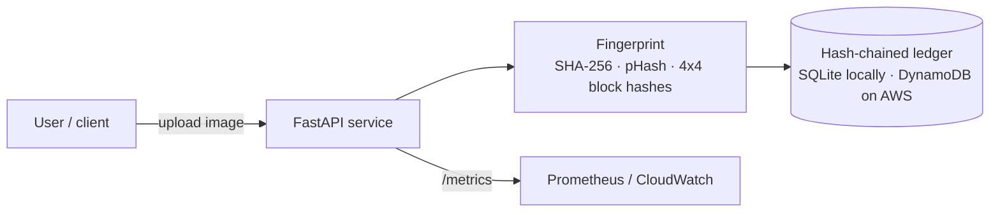
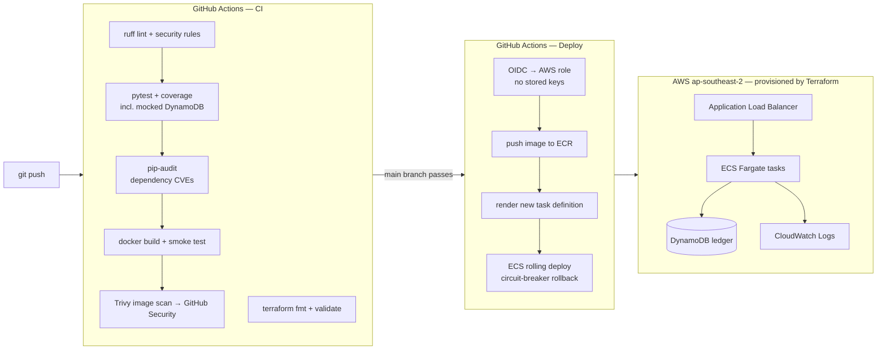

# VeriFrame — image integrity & tamper detection

[](https://github.com/KTVshwajith/veriframe/actions/workflows/ci.yml)

VeriFrame lets you **register an original image** and later **check any copy of it**. For each copy it gives one of four answers:

| Verdict | Meaning |
|---|---|
| `authentic` | Byte-for-byte identical to the registered original |
| `authentic_reencoded` | Same picture, but re-saved, compressed or resized (e.g. sent through a messaging app) |
| `tampered` | Matches a registered original, but some regions were changed. The changed regions are returned and highlighted. |
| `unknown` | Not derived from any registered image |

Every registration is written to an **append-only, hash-chained ledger**: each entry contains the hash of the previous one. Editing or deleting any past record breaks the chain, and `GET /api/v1/ledger/verify` detects it.

## Where this comes from

This project turns my doctoral research into a deployable service. My PhD (AUT, 2024) was *Computational methods for video blockchain in intelligent surveillance*, and it covered ways to make digital evidence tamper-evident. VeriFrame packages two ideas from that work, applied to still images, as a cloud-native service:

* hash-chained integrity records
* content-aware fingerprints that still recognise an image after compression

Related publications:
* Moolikagedara et al. (2024). *Advancing video data privacy preservation in IoT networks through video blockchain.* Information, 15(3), 171.
* Moolikagedara et al. (2023). *Video blockchain: A decentralised approach for secure and sustainable networks…* Electronics, 12(17), 3621.
* Moolikagedara (2025). *Blockchain-powered authentication: Reinforcing identification for misinformation in AI-generated videos.* Rangahau Aranga: AUT Graduate Review, 4(1).

## How it works



Each image gets three fingerprints:

1. **SHA-256** of the file: an exact match proves the copy is untouched.
2. **Perceptual hash (pHash)**: unchanged by JPEG compression, resizing and format changes, so the original can still be found.
3. **Block hashes (4×4 grid)**: one hash per region. When a copy has changed, these show *where* it changed.

## Delivery pipeline (DevOps)



| Area | What is in the repo |
|---|---|
| Containerisation | Multi-stage `Dockerfile`, non-root user, health check; `docker-compose.yml` with DynamoDB Local |
| CI | `.github/workflows/ci.yml`: lint, tests, dependency audit, image build, smoke test, Trivy scan, Terraform validate |
| CD | `.github/workflows/deploy.yml`: GitHub OIDC to AWS, ECR push, ECS rolling deploy with automatic rollback |
| Infrastructure as code | `infra/terraform/`: ECR, DynamoDB (encrypted, PITR), ECS Fargate, ALB, security groups, least-privilege IAM, OIDC deploy role |
| Orchestration | `k8s/veriframe.yaml`: Deployment, Service, ConfigMap, PVC, probes, resource limits, hardened security context |
| DevSecOps | Bandit rules via ruff, pip-audit, Trivy, ECR scan-on-push, Dependabot, no long-lived cloud credentials |
| Observability | Structured JSON logs, Prometheus metrics at `/metrics`, ECS Container Insights |

## Run it

```bash
# Local Python
make install && make run          # http://localhost:8000  (API docs at /docs)
make test

# Docker
make docker

# Docker + DynamoDB Local (exercises the AWS code path)
make compose

# Kubernetes (kind)
make k8s
kubectl -n veriframe port-forward svc/veriframe 8000:80
```

### Deploy to AWS

```bash
cd infra/terraform
terraform init
terraform apply                       # creates ECR, DynamoDB, ECS, ALB, IAM

# Push a first image (later pushes are automatic via GitHub Actions)
aws ecr get-login-password --region ap-southeast-2 | docker login --username AWS --password-stdin $(terraform output -raw ecr_repository_url | cut -d/ -f1)
docker build -t $(terraform output -raw ecr_repository_url):latest ../..
docker push $(terraform output -raw ecr_repository_url):latest

terraform output app_url              # open in a browser
```

To turn on continuous deployment, add a repository variable `AWS_DEPLOY_ROLE_ARN` set to `terraform output -raw github_deploy_role_arn`, and create a GitHub environment called `production`.

> **Cost note:** the load balancer and Fargate task cost a small amount per hour. Run `terraform destroy` when you're not demoing.

## API

| Method | Path | Purpose |
|---|---|---|
| `POST` | `/api/v1/images/register` | Upload `file` (+ optional `label`) → certificate and ledger entry |
| `POST` | `/api/v1/images/verify` | Upload `file` → verdict + changed regions |
| `GET` | `/api/v1/certificates/{cert_id}` | Look up a certificate |
| `GET` | `/api/v1/ledger/verify` | Re-check the whole hash chain |
| `GET` | `/health` | Liveness/readiness |
| `GET` | `/metrics` | Prometheus metrics |

## Limitations & roadmap

* Matching scans every ledger entry, which is fine for thousands of images. Larger volumes need an index (e.g. BK-tree or vector search) and DynamoDB GSIs.
* The ledger lives in a single database. A next step is anchoring periodic chain checkpoints to a public blockchain or a transparency log.
* Planned: an AI-generated-image detector as a second signal, C2PA content-credential support, signed certificates (KMS), and HTTPS with a custom domain.

## Licence

MIT
